<div align="center">



<br /><br />

<a href="https://culturalstudies.in/journal/index.php/JCRS"></a>


</div>

## About

The Journal of Cultural Research Studies (JCRS) is a blind peer-reviewed, open access, multilingual (English and Bengali) journal on folklore, tribal and indigenous studies, literature, performing and visual arts and regional heritage. It is published twice a year by the Development and Research Academy for Folk and Tribes (DRAFT), Kolkata, and runs on Open Journal Systems.

This repository holds the **OJS 3.3 customisation** behind the journal's website: a mobile-first style sheet, page content for every main page, a small Python build that previews the whole site locally and produces paste-ready OJS blocks, and a plugin that adds article information to issue pages.

## OJS 3.3 customisation

**Design:** maroon `#7a2414` with a gold accent `#c8952e`, Playfair Display headings, Source Sans 3 body text and Noto Serif Bengali for Bengali content.

### 1. Theme and pages (`src/`)

| File | Purpose | Where it goes in OJS |
|---|---|---|
| `jcrs-custom.css` | Mobile-first style sheet for the Default theme: header, menu, home page, issue table of contents, archive cards, sidebar and footer | Settings → Website → Appearance → Advanced → **Journal style sheet** |
| `pages/home.html` | About panel with journal profile and Call for Papers cards | Settings → Website → Appearance → Setup → **Additional content** |
| `pages/about.html` | Journal at a glance, aims and scope, subject areas, publication policies | Settings → Journal → Masthead → **About the Journal** |
| `pages/editorial-team.html` | Editor-in-Chief, Editorial Board and Managing Editors | Settings → Journal → Masthead → **Editorial Team** |
| `pages/author-guidelines.html` | Submission guidelines | Settings → Workflow → Submission → **Author Guidelines** |
| `pages/contact.html` | Contact cards | Settings → Journal → Contact → **Mailing Address** |
| `pages/current-issue.html`, `pages/archives.html` | Generated by OJS; only styled. Used for the local preview. | Issue description only |
| `blocks/footer.html` | Site footer | Settings → Website → Appearance → Setup → **Page footer** |
| `blocks/editor-in-chief.html` | Editor-in-Chief sidebar block | Custom Block Manager plugin → new block |
| `shell.html`, `preview.css` | Header, menu and sidebar for the local preview only | Not uploaded |

### 2. Site builder (`build.py`, `toc.py`)

```bash
python build.py
```

| Output | What it is |
|---|---|
| `site/` | Full preview of the website with working links. Open `site/index.html`. |
| `ojs/` | Paste-ready blocks with the real journal URLs filled in, plus the issue description and sidebar block |

Page content uses tokens such as `{{about}}`, `{{current}}` and `{{img:editor-in-chief.jpg}}`; the builder swaps them for preview links or live OJS links. `toc.py` builds the issue table of contents and archive cards from `src/data/current-issue.json` and `src/data/archive.json`.

### 3. Article information plugin (`plugin/jcrsArticleInfo/`)

A small generic plugin for OJS 3.3. It is **read-only**: it only reads the existing usage statistics.

- Shows **abstract views** and **downloads** under every article in issue tables of contents
- Adds an expandable **abstract with keywords** to each article
- Uses the `Templates::Issue::Issue::Article` hook that the Default theme already calls, so no theme templates are overridden

**Install:** copy the folder to `plugins/generic/jcrsArticleInfo/`, then enable it under Settings → Website → Plugins.

## How to use

1. Run `python build.py` and check the preview in `site/`.
2. Upload `jcrs-custom.css` as the journal style sheet.
3. Paste each block from `ojs/` into the OJS field named at the top of its file (use the editor's Source code `< >` button).
4. Install and enable the plugin.
5. Replace the placeholders (`Editor Name`, `Member Name 1`, `editor@example.org`, `+91 00000 00000`, the sample articles in `current-issue.json`) with your own details, and add `src/img/editor-in-chief.jpg`.

> **Note:** No passwords, account details or personal data are included in this repository. Names, contact details and article data are sample placeholders.

## Built with

`OJS 3.3` · `PHP` · `CSS` · `HTML` · `Python` · `Smarty hooks`

## Maintainer

Built and maintained by **[Dr. Amalendu Das](https://github.com/amalendu-ls)**, Librarian, Nabadwip Vidyasagar College.
[Portfolio](https://sites.google.com/nvc.ac.in/amalendudas/home_1) · [ORCID](https://orcid.org/0000-0003-0799-0599)
